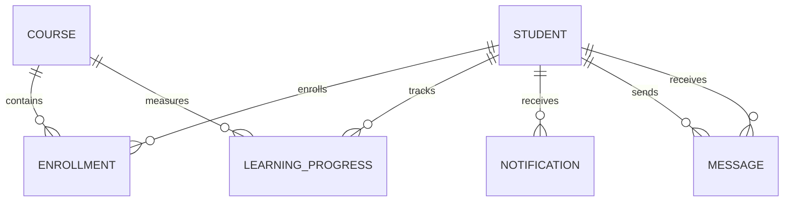

# Student Course Management System
## MongoDB Database Schema and Relationships

### Database
MongoDB — course_management

### Collections

#### 1. Students
- id: String, required, unique
- name: String
- email: String, required
- password: String, excluded from default Mongoose queries
- department: String
- active: Boolean
- createdAt, updatedAt: Date

#### 2. Courses
- id: String, required, unique
- title: String, required
- description: String
- courseKey, key: String
- videos: Array
- materials: Array
- createdAt, updatedAt: Date

#### 3. Enrollments
- id: String, required, unique
- studentId: String
- courseId: String
- studentEmail: String
- courseKey, title, course: String
- status: String
- completed: Boolean
- completionDate: String
- createdAt, updatedAt: Date

#### 4. Learning Progress
- id: String, required, unique
- studentId: String
- courseId: String
- studentEmail: String
- completedVideos: Array
- totalVideos: Number
- percentage: Number
- completed: Boolean
- startedAt, updatedAt, completedAt: String

#### 5. Notifications
- recipient: String, required
- message: String, required, maximum 500 characters
- isRead: Boolean
- createdAt, updatedAt: Date

#### 6. Messages
- sender: String, required
- recipient: String, required
- text: String, required, maximum 2000 characters
- createdAt, updatedAt: Date

### ER Diagram

### Relationships

1. A student can have multiple enrollments.
2. A course can have multiple enrollments.
3. Enrollment connects students and courses using string IDs.
4. Learning progress connects a student to a course.
5. A student can receive multiple notifications.
6. A student can send and receive multiple messages.

### Indexes and Constraints

- Students: unique id; non-unique email index.
- Courses: unique id.
- Enrollments: unique id; non-unique compound index on studentId and courseId.
- Learning Progress: unique id; non-unique compound index on studentId and courseId.
- Notifications: compound index on recipient and createdAt.
- Messages: compound index on sender, recipient and createdAt.

### Design Notes

- MongoDB generates an _id for every document.
- The existing application also uses string-based IDs.
- Relationships are logical references using those IDs.
- MongoDB does not automatically enforce these cross-collection relationships.
- Existing Enrollment and LearningProgress schemas do not enforce unique student/course pairs.
- Existing application schemas are preserved to avoid disrupting working functionality.
